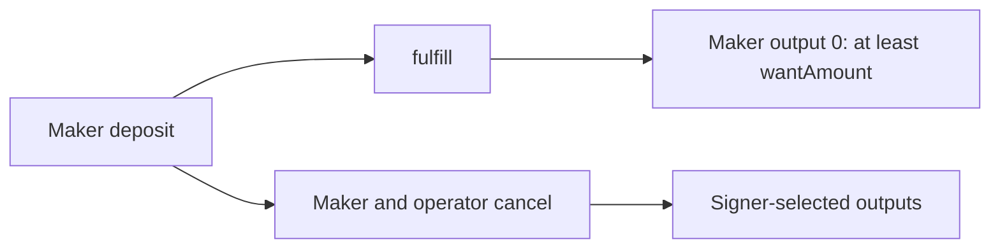

# Swap offer contracts

`swap-want-btc.ark` and `swap-want-asset.ark` are the source for new offers.
`fulfill` pays output 0 to the committed maker program, with at least
`wantAmount` sats or units of the wanted asset. `cancel` requires the maker and
operator signatures. The SDK appends the optional maker-only CSV exit after
those two leaves.

Generate with `pnpm -C packages/swap contracts:generate`; verify with
`pnpm -C packages/swap contracts:check`. The command builds clean compiler
`e264d5e6ecd044de7130d5c8a0e1f49d43958c11` with Cargo's locked dependencies.
`ARKADE_COMPILER_SOURCE` may point to an existing clean checkout at that exact
revision. Artifacts retain the source bundle, compiler options and fingerprint;
only `updatedAt` is removed. Local binary/toolchain evidence is written under
`.tmp/swap-compiler/`.

The compiler's numeric witness-version equality changes new offer addresses.
The frozen programs under `src/legacy/` rebuild previously encoded offers and
stored rows; regeneration never rewrites those programs or funded addresses.
