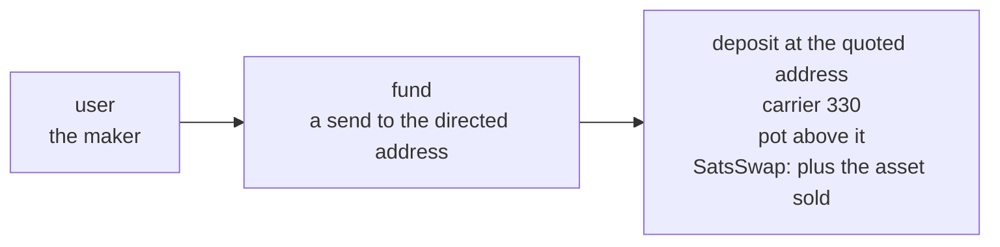
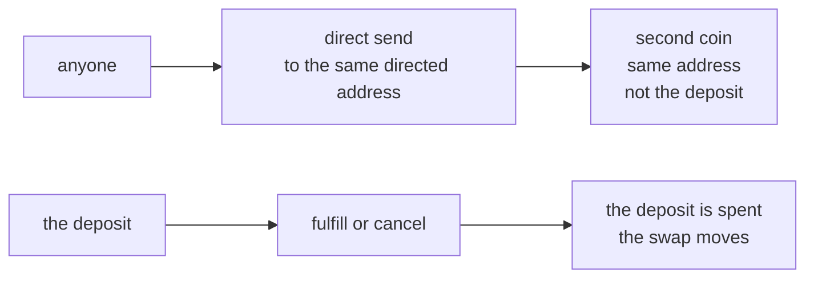
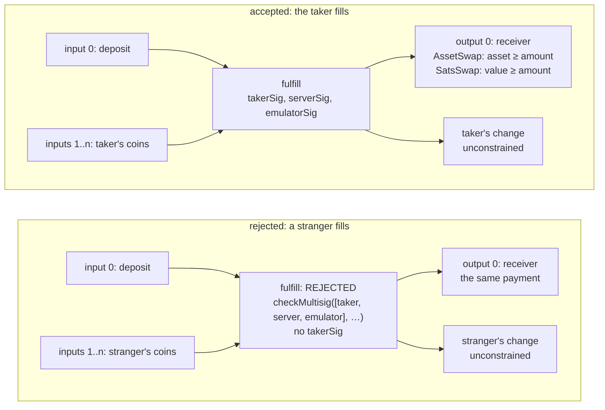
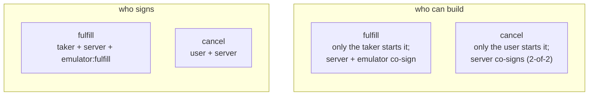

# Swap contracts

`asset-swap-directed.ark` and `sats-swap-directed.ark` are the directed asset swaps: only
`taker`, the key of the solver that quoted the swap, can complete a funded deposit through
`fulfill`. Each declares a `fulfill` tapscript that replaces the leaf the compiler would otherwise
synthesize for `fulfill`.

`asset-swap-directed-nonce.ark` and `sats-swap-directed-nonce.ark` bind a 32-byte
RFQ commitment into `fulfill`. With optimized `arkadec` 0.1.1, its
self-comparison compiles to a nonce push and drop. Distinct RFQs get distinct
addresses even when they pay the same amount to the same receiver. Both
variants follow the spend paths below.

The nonce pair names the operator once per leaf: `fulfill` is `taker` and the operator key
tweaked by `fulfill`, `cancel` is `user` and the operator key. `programFromArtifact` reads that,
by default, as the server key beside the `fulfill`-tweaked emulator key, the leaves drawn below,
so existing deposits keep their addresses.

Regenerate the nonce artifacts from this directory with `arkadec` 0.1.1, built from compiler
commit `bec2d5a79157d6af4e0041a35b89880a1d683240`.

```sh
arkadec --deny warnings asset-swap-directed-nonce.ark -o asset-swap-directed-nonce.json
arkadec --deny warnings sats-swap-directed-nonce.ark -o sats-swap-directed-nonce.json
```

## 1. The coin the person sends



The deposit is the coin the swap tracks. `fulfill` never inspects it.

## 2. The direct send



A direct send creates a second coin beside the deposit. Only a spend of the deposit moves the swap.

## 3. The rejected transaction



The stranger pays the receiver exactly as the taker does, so the covenant passes. The spend fails
only on the leaf's missing `takerSig`.

## 4. Who signs



A `require` is not authorization: it checks the transaction, not who may move the coins.

**Enforced:** output *i*, at the deposit's input index, pays the v1 program `receiver` at least
`amount` (units of `assetTxid`/`assetGroupIndex`, or sats); `fulfill` needs `taker`, the Arkade
Service and the `fulfill`-tweaked emulator; `cancel` needs `user` and the Arkade Service.

**Not claimed:** the quote's price, the solver's liveness (`cancel`, and the `exit` leaf that
`withExitClosure` appends, return the deposit without it), any output other than *i*, and partial
fills, which are unspecified for the directed versions.
