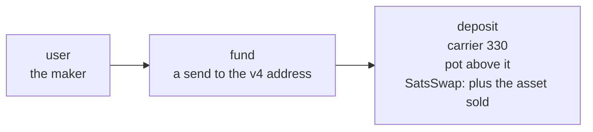
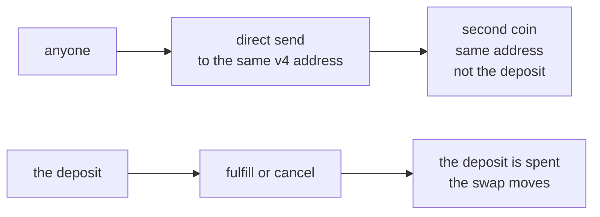
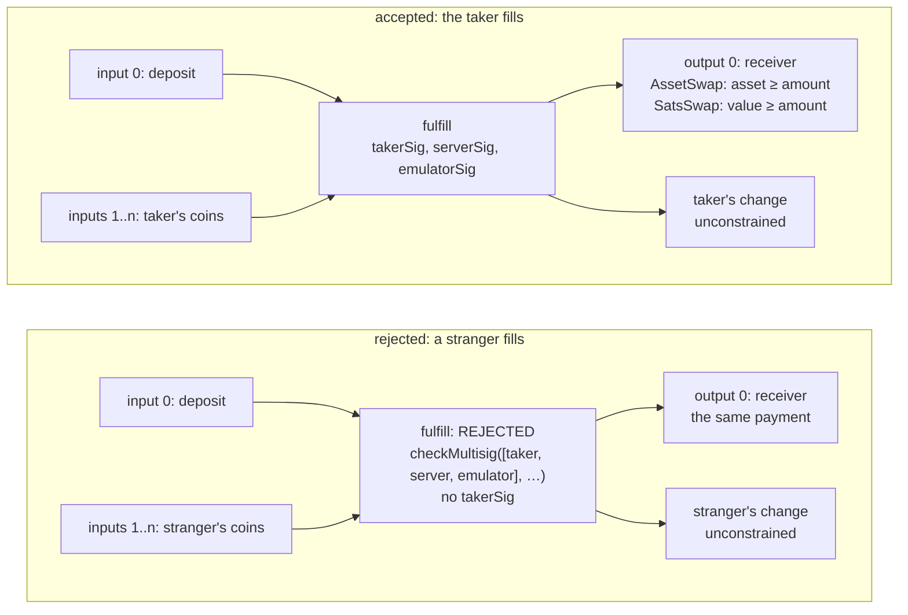
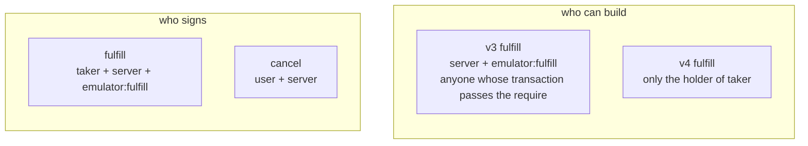

# Swap contracts

`asset-swap.ark` and `sats-swap.ark` (v3) let anyone complete a funded deposit through `fulfill`.
`asset-swap-v4.ark` and `sats-swap-v4.ark` are the directed versions: only `taker`, the key of the
solver that quoted the swap, can. Each adds `taker` to its v3 constructor, and a `fulfill`
tapscript that replaces the leaf the compiler would otherwise synthesize for `fulfill`.

## 1. The coin the person sends

The deposit is the coin the swap tracks. `fulfill` never inspects it.

## 2. The direct send

A direct send creates a second coin beside the deposit. Only a spend of the deposit moves the swap.

## 3. The rejected transaction

The stranger pays the receiver exactly as the taker does, so the covenant passes. The spend fails
only on the leaf's missing `takerSig`.

## 4. Who signs

A `require` is not authorization: it checks the transaction, not who may move the coins.

**Enforced:** output *i*, at the deposit's input index, pays the v1 program `receiver` at least
`amount` (units of `assetTxid`/`assetGroupIndex`, or sats); `fulfill` needs `taker`, the Arkade
Service and the `fulfill`-tweaked emulator; `cancel` needs `user` and the Arkade Service.

**Not claimed:** the quote's price, the solver's liveness (`cancel`, and the `exit` leaf that
`withExitClosure` appends, return the deposit without it), any output other than *i*, and partial
fills, which are unspecified for the directed versions.
