# Solver quote failover

`SolverFailover.tla` checks one quote request over two candidates with two concurrent accept callers. Requests and delayed responses are separate events; timeout/refusal closes an attempt, and only preparation may advance. Returning a quote fixes its solver before acceptance. Acceptance reads storage, persists a record, then submits funding. An error before submission or a lost response afterwards leaves acceptance bound to that record. Duplicate acceptance reuses the record under serialization.

```mermaid
stateDiagram-v2
    [*] --> Preparing
    Preparing --> Pending: start isolated attempt
    Pending --> Preparing: candidate failure; close; next exists
    Pending --> Exhausted: candidate failure; no next
    Pending --> Quoted: current live response; close attempt
    Preparing --> Preparing: ignore stale response
    Quoted --> Returned: return pinned quote
    Returned --> Accepting: accept pinned preparation
    Accepting --> Persisted: serialized read then durable write
    Persisted --> Funded: submit using durable identity
    Persisted --> Uncertain: pre-submit error
    Funded --> Uncertain: lost acknowledgement
    Funded --> Done: acknowledgement
    Uncertain --> Accepting: same quote and durable record
    Accepting --> Done: duplicate reuses durable record
    Preparing --> Disposed: cancel; close; never advance
    Pending --> Disposed: cancel; close; ignore late response
    Quoted --> Disposed: dispose
    Returned --> Disposed: dispose before acceptance
```



Invariants: `NoDoubleFunding`, `AcceptedSolverPinned`, `StaleResponseCannotWin`, `NoFailoverAfterAccept`, `DisposalClosesAttempts`, and `TypeOK`. Four separate configurations remove preparation pinning, stale-response filtering, the post-accept retry fence, or accept serialization. Each must violate its named invariant. `_Sim.cfg` expands to four candidates.

Using the `tla-model` skill CLI (set `JAVA` to a Java 11+ executable when needed):

```text
node <skill>/scripts/tla.mjs check spec/tla/SolverFailover --coverage --workers 1
node <skill>/scripts/tla.mjs sweep spec/tla
node <skill>/scripts/tla.mjs sim spec/tla/SolverFailover --cfg SolverFailover_Sim.cfg --num 20000 --depth 100 --seed 20261109
node <skill>/scripts/tla.mjs trace spec/tla/SolverFailover --cfg SolverFailover_Stale.cfg
```

The model abstracts prices, amounts, signatures, chain finality, storage implementation, cross-process coordination, TTLs, and transport internals. `wire` permits delayed responses and models a lost response by omitting delivery. `FailAttempt` represents only candidate-local failures; invalid caller input and policy/storage errors must terminate instead. Disposal represents cancellation before acceptance. Terminal states may stutter; no liveness property is claimed.

`Reuse` abstracts reconciliation/recovery within an existing durable identity; it does not prove that backend submission itself is idempotent. Record IDs represent independently created acceptance executions for the same quote ID, making the missing-serialization mutant detect two funded executions. Production concurrency beyond the existing per-quote serialization remains outside this model. Header anchors identify the code guards that tests must exercise.
